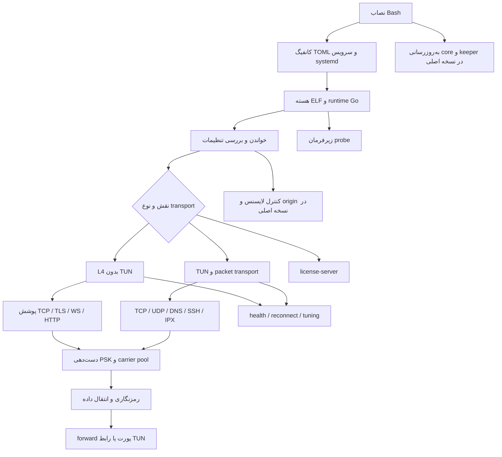

# ساختار بازیابی‌شدهٔ pengutunnel

این نقشه بر اساس نصاب بازشده، فرادادهٔ Go، اسمبلی، stackهای بازیابی‌شده و آزمون‌های محلی تهیه شده است. استخراج تمام کد ماشین انجام شده؛ فهم تمام جزئیات آن یا بازسازی کامل سورس اصلی ادعا نمی‌شود.

## لایهٔ نصب

ورودی install.sh با Base64 و gzip بسته‌بندی و با eval اجرا می‌شود. محتوای بازشده Bash، نسخهٔ 4.2.6 است؛ هستهٔ دریافت‌شده نسخهٔ v5.1.3 را اعلام می‌کند. این دو شماره مربوط به دو جزء متفاوت‌اند.

نصاب اصلی باینری، TOMLها و لاگ‌ها را زیر `/root/pengutunnel` نگه می‌دارد و برای تونل‌ها unitهای `/etc/systemd/system/pengutunnel-*.service` می‌سازد. سرویس‌های TUN به قابلیت‌های شبکه نیاز دارند. نصاب تنظیمات transport را می‌پرسد و می‌نویسد؛ پیاده‌سازی انتقال داده در باینری است.

به‌روزرسانی core در نسخهٔ اصلی با timer دوره‌ای و keeper با timer جدا انجام می‌شود. این timerها بخشی از اسکریپت و systemd هستند؛ نباید با goroutineهای داخل هسته یکی گرفته شوند. نصاب محلی آفلاین مسیر دریافت core و script از upstream را کنار گذاشته است.

## لایهٔ فایل اجرایی

هسته ELF64، Linux AMD64 و کامپایل‌شده با Go است. UPX از آن باز شده است. در build info نسخهٔ Go به unknown تبدیل شده و اطلاعات module خالی است. ۴۲٬۲۲۰ تابع از جدول تابع‌ها استخراج شده‌اند؛ ۳۵٬۷۷۵ مورد نام خالی دارند و بعضی نام‌های باقی‌مانده نیز مبهم‌اند.

وجود کد کتابخانه در باینری، به معنی استفادهٔ فعال آن در همهٔ transportها نیست. برای مثال وجود کتابخانهٔ RSA یا TLS، اثبات استفادهٔ RSA برای لایسنس نیست؛ مسیر مشاهده‌شدهٔ امضای لایسنس به Ed25519 می‌رسد.

## پیکربندی

ساختار root از ۱۱ بخش تشکیل شده است: `transport`، `tun`، `security`، `license`، `health`، `license_server`، `tuning`، `logging`، `forward`، `xui_iplimit` و `ipx`. در مجموع ۷۹ نام tag یکتای TOML در باینری دیده شد. ۱۲ ساختار شامل root و بخش‌های داخلی، همراه نوع فیلد و offset بازیابی شده‌اند.

فهرست بخش‌ها و فیلدها در `CONFIG-STRUCTURE.fa.md` و دادهٔ خام در `config-schema-recovered.json` قرار دارد. نام بسیاری از فیلدهای Go مبهم شده، اما tagهای TOML برای خواندن پیکربندی باقی مانده‌اند. وجود یک گزینه، درست بودن پیاده‌سازی آن یا مقدار پیش‌فرضش را ثابت نمی‌کند.

## نقطهٔ شروع و dispatch

تابع اصلی در همین build در `0x1ed3060` و dispatch در `0x1ed3be0` قرار دارد. زیر‌فرمان `probe` پیش از پردازش معمول flags تشخیص داده می‌شود. گزینه‌های help مشاهده‌شده شامل config، log و version هستند.

در dispatch، نقش‌های `client`، `server` و `dualway` دیده می‌شوند. نوع‌های L4 مانند tcpfwd، tls، ws، wss، xhttp و xhttps به مسیر L4 می‌روند؛ مسیرهای TUN و packet مسیرهای دیگر دارند. نقش منطقی و جهت dial/listen یک مفهوم واحد نیستند: در حالت direct ممکن است سمت forwarding تماس را آغاز کند و سمت exit گوش دهد.

**نکتهٔ بازیابی‌شدهٔ جدید:** رشتهٔ `license-server` مستقیماً در dispatch وجود دارد و بخش تنظیمات `license_server` شامل listen، db، signing_key، trust_proxy، hmac_compat، min_core_version و token_secret است. بنابراین خود باینری کد/حالت سرویس لایسنس هم دارد. رفتار کامل این حالت هنوز اجرا و تحلیل نشده است؛ مقدار signing_key نام یک گزینه است و به معنی یافتن کلید خصوصی ناشر نیست. گفتهٔ قبلی دربارهٔ پیدا نشدن کلید خصوصی همچنان پابرجاست، ولی نبود هیچ کد سرویس لایسنس در هسته را نباید فرض کرد.

## مسیر دادهٔ L4

در آزمون‌ها یک سرویس echo پشت exit قرار داشت. اتصال ورودی روی edge به carrier رفت، در طرف مقابل به مقصد forward شد و داده عیناً بازگشت. چند اتصال کاربر می‌توانند روی pool محدود carrierها سوار شوند؛ لاگ‌ها تعداد carrier و وضعیت pool را گزارش می‌کنند.

tcpfwd پوشش مستقیم TCP دارد. TLS یک پوشش TLS اضافه می‌کند. WS/WSS از WebSocket استفاده می‌کنند و XHTTP/XHTTPS پوشش HTTP دارند. مسیرهای CDN، hostname، SNI و fingerprint در نصاب و schema وجود دارند؛ CDN واقعی و درستی تقلید fingerprint در این مرحله آزموده نشده‌اند.

دست‌دهی PSK مستقل از لایسنس است. پس از حذف وابستگی لایسنس، کلید PSK اشتباه همچنان رد شد. داده در حالت‌های AES-GCM و یک نمونهٔ ChaCha20 رفت‌وبرگشت موفق داشت؛ این آزمون، بررسی جامع nonce، key derivation یا امنیت رمزنگاری نیست.

## مسیر TUN و packet

رابط TUN، آدرس، MTU و health_port در تنظیمات وجود دارند. نصاب TCP، UDP، DNS، SSH و IPX را معرفی می‌کند؛ IPX دارای profileهای ICMP، IPIP، OSPF، GRE، AH و ESP است و گزینه‌های source/peer spoof دارد. متدهای ReadPacket و WritePacket نیز در فرادادهٔ باینری دیده می‌شوند.

این بخش از نظر ساختار شناسایی شده، ولی انتقال واقعی TUN/raw IP در sandbox فعلی آزمون کامل نداشته است. نمی‌توان نتیجهٔ L4 را به آن تعمیم داد یا از نام یک profile نتیجه گرفت که همان پروتکل استاندارد کامل پیاده‌سازی شده است.

## لایسنس و کنترل‌های پس‌زمینه

در build اصلی، client درخواست `/verify` را با nonce، کلید، IP، نسخه و مشخصات تونل آماده می‌کند. اعتبار TLS، امضای پاسخ، IP، انقضا و پاسخ رد کنترل می‌شوند. سمت دیگر نیز proof و IP origin را بررسی می‌کند. علاوه بر شروع اتصال، کنترل origin می‌تواند worker پس‌زمینه و مهلت fail-closed ایجاد کند.

در کپی نهایی آفلاین، بررسی اولیه، پیش‌درخواست IP برای لایسنس reverse L4 و راه‌اندازی کنترلر origin کنار گذاشته شده‌اند. این نسخه token ساختگی یا امضای جعلی صادر نمی‌کند. شرح تغییرها و آزمون‌ها در `OFFLINE-RESULT.fa.md` است. پیاده‌سازی عمومی Ed25519 و TLS در آن تغییر نکرده‌اند.

## مانیتورینگ و کنترل جانبی

health یک endpoint محلی HTTP با فیلدهایی مانند alive، peers، role، transport و uptime_s دارد. در حالت وصل‌نشده HTTP 503 و در آزمون موفق HTTP 200 مشاهده شد. خاموش کردن server می‌تواند پیام restart به peer بدهد و client با خروج غیرصفر از نو راه‌اندازی شود؛ systemd این چرخه را مدیریت می‌کند.

تنظیم workers بر GOMAXPROCS اثر دارد. stream_window، pool، profile و bufferها برای tuning وجود دارند. مقدار پیش‌فرض auto در لاگ از حافظهٔ قابل مشاهده محاسبه می‌شود. ظرفیت، عدالت بین streamها و مصرف منابع در بار واقعی هنوز سنجیده نشده است.

xui_iplimit در نصاب نقش watcher/enforcer دارد: watcher از fail2ban وضعیت ban را می‌خواند و enforcer روی ingress محدودیت را اعمال می‌کند. تنظیمات و منو دیده شده‌اند؛ اصالت پیام کنترل، دامنهٔ اختیار، قواعد iptables و چرخهٔ رفع ban در این مرحله بررسی جامع نشده‌اند.

## مرز دانسته‌ها

| جزء | شواهد فعلی |
|---|---|
| نصاب و تولید systemd/TOML | متن بازشده و بررسی استاتیک |
| تمام کد ماشین | استخراج اسمبلی و جدول تابع‌ها |
| schema تنظیمات | بازیابی از فرادادهٔ نوع‌ها |
| لایسنس client و امضای پاسخ | اسمبلی، probe و آزمون محلی |
| شش transport اصلی L4 | رفت‌وبرگشت واقعی در loopback |
| direct TCP/TLS و ChaCha روی TCP | آزمون محلی موفق |
| رد PSK متفاوت | آزمون محلی موفق |
| حالت license-server | شناسایی در dispatch/schema؛ تحلیل کامل باقی است |
| TUN/raw IP/CDN/spoof/ban sync | فقط شواهد استاتیک/تنظیمات؛ آزمون کامل باقی است |
| پایداری طولانی و همهٔ مسیرهای خروج داده | اثبات نشده |

این گزارش نقشهٔ ساختار و شواهد موجود است. ادعای فهم همهٔ شاخه‌های ۴۲ هزار تابع، نبود در پشتی یا بازیابی کامل سورس با نتایج فعلی پشتیبانی نمی‌شود.
